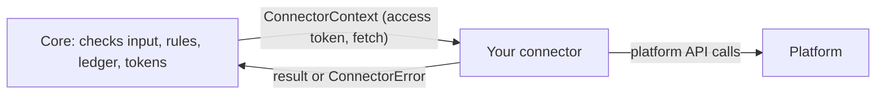

# Writing a connector

A connector teaches Channel Hub one platform. Core does everything shared: storing secrets, OAuth, app keys, the
publish log, the safety rules and the audit log. A connector only describes the platform and makes its API calls.

The arrow into your connector carries only an access token and `fetch`: a connector never sees the vault, other
accounts or which app asked.

## The interface

Defined in [`src/core/types.ts`](src/core/types.ts):

| Field | What to provide |
|---|---|
| `id`, `name` | `"tiktok"`, `"TikTok"`. Account ids become `tiktok:<external id>`. |
| `credentials` | App-level secrets, by env name, e.g. `{ env: "TIKTOK_CLIENT_KEY", label: "...", secret: true }`. Read from `.env.local`; `doctor` lists missing ones. |
| `auth` | `{ kind: "oauth2", authorizeUrl, tokenUrl, scopes, clientIdEnv, clientSecretEnv, extraParams?, pkce? }` or `{ kind: "api_key", label }`. Core runs the flow and refreshes tokens. |
| `capabilities` | Any of `video.upload`, `captions.upload`, `video.status`, `video.visibility`. |
| `capabilityScopes` | Optional, OAuth only: which granted scopes enable each capability (any of the list). |
| `visibilities` | Which of `private`, `unlisted`, `public` the platform supports. |
| `limits` | Title, description and tag limits, allowed file extensions, max file size. |
| `options` | A zod schema for platform-only fields. Make policy fields required so callers cannot skip them. |
| `validate` | Optional extra checks before any call; return a message to refuse. |
| `account(ctx)` | Who was just connected: `{ externalId, name }`. |
| `upload(ctx, input)` | Publish `input.bytes` (the exact bytes core hashed; do not re-read the file); return `{ externalId, url }`. Set a timeout on the transfer. |
| `captions`, `status`, `setVisibility` | For the capabilities you declared. |

## Errors decide what core does

- Throw `ConnectorError(kind, message, status)` when the platform answered: `authorization` (reconnect),
  `permission` (missing scope), `quota`, `transient`, `invalid`, `session_expired`. The upload is recorded as `failed`.
- Throw `UnknownOutcome(message)` when the platform may have the post but did not confirm it: the connection dropped,
  timed out, or the server answered 5xx/408/429 after the video bytes were sent. Core records `unknown` and blocks the
  file until the caller checks the platform. Any other unexpected error during `upload` is treated the same way.
- Wrap network errors in calls that cannot create a post (session start, lookups) as `ConnectorError("transient")`.
- Never put tokens or keys in error messages.

## Register and test

1. Add `src/connectors/<id>/index.ts` exporting a factory, and add it to [`src/connectors/index.ts`](src/connectors/index.ts).
2. Add a fake of the platform's API in `test/` (see [`test/fake-youtube.mjs`](test/fake-youtube.mjs)) and tests like
   [`test/youtube.test.mjs`](test/youtube.test.mjs): the request carries the right fields, refusals map to the right
   kinds, a dropped upload is `unknown`. [`test/fake-connector.mjs`](test/fake-connector.mjs) is the smallest example.
3. Document the platform's options and setup in the README.
