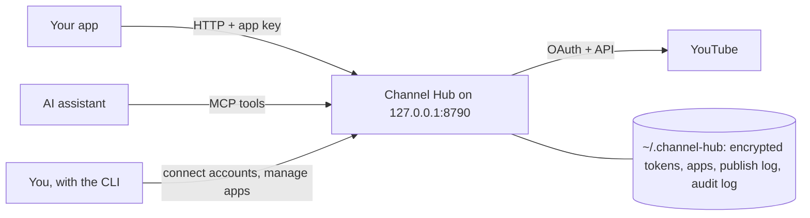
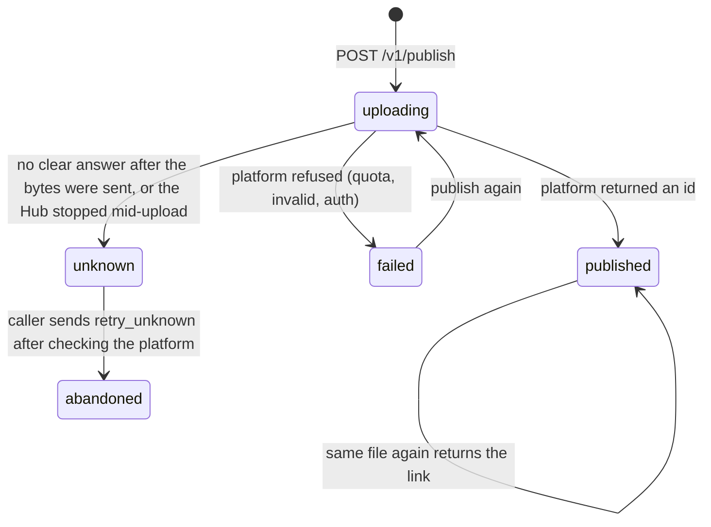

# Channel Hub

Connect your publishing accounts once, then publish to them from any app or AI assistant on your machine, without
setting up publishing in every project. YouTube is the first connector; the core is platform-neutral, so others plug in.

- **Local and self-hosted.** One process on `127.0.0.1`. Your tokens never leave your machine except to the platform.
- **One connection, many apps.** Each app gets its own key and may use only the accounts you list for it.
- **Safe by default.** Private unless asked; public needs an explicit confirmation; the same file is never uploaded twice
  to one account; an upload with an unknown outcome is never retried by itself; a captions failure never removes a video.
- **For people and for assistants.** An HTTP API for apps and MCP tools for assistants (Claude, Codex, ...).



*App* is any program of yours that publishes. *Hub* is this service. *Data* is the folder where the Hub keeps its
state; account tokens there are encrypted with your master key.

## Install

Requires Node.js 22 or later.

```bash
git clone https://github.com/Mouad1/channel-hub.git
cd channel-hub
npm install
npm run build
cp .env.example .env.local
```

Fill `.env.local` (it is git-ignored; never commit it):

| Name | What |
|---|---|
| `CHANNEL_HUB_MASTER_KEY` | Encrypts account tokens. A long random string: `openssl rand -base64 48`. Keep a copy somewhere safe; without it, accounts must be reconnected. |
| `GOOGLE_CLIENT_ID`, `GOOGLE_CLIENT_SECRET` | A Google OAuth client for YouTube (below). |
| `CHANNEL_HUB_PORT` | Optional, default `8790`. |
| `CHANNEL_HUB_HOME` | Optional data folder, default `~/.channel-hub`. A `.env.local` there is read too. |

### Google OAuth client (YouTube)

1. In [Google Cloud Console](https://console.cloud.google.com/), create or pick a project and enable **YouTube Data API v3**.
2. Configure the OAuth consent screen. While the app is in **Testing**, add your Google account as a test user. Note:
   in Testing mode Google expires refresh tokens after 7 days, so you will need to reconnect weekly until the app is
   published (In production).
3. Create an OAuth client (type *Web application*) with this authorized redirect URI:
   `http://127.0.0.1:8790/oauth/callback/youtube` (use your port if you changed it).
4. Put the client ID and secret in `.env.local`.

Check everything with:

```bash
node dist/cli.js doctor
```

## Run it and connect a channel

```bash
node dist/cli.js start
```

Keep it running (a terminal tab, or a login item / launchd / systemd service). In another terminal:

```bash
node dist/cli.js connect youtube
```

Your browser opens Google's consent page. Pick the channel's Google account and allow every permission: upload,
read, and manage captions (`youtube.upload`, `youtube.readonly`, `youtube.force-ssl`). Then:

```bash
node dist/cli.js accounts
```

shows something like `youtube:UCxxxx  My Channel  connected  video.upload,captions.upload,video.status,video.visibility`.
Run `connect` again any time to reconnect (for example after a revoked or expired token, or to grant a missing
permission). Each channel is its own account; connect as many as you like.

## Give an app a key

```bash
node dist/cli.js apps add my-app --accounts youtube:UCxxxx --write-env ../my-app/.env.local
```

This writes `CHANNEL_HUB_URL` and `CHANNEL_HUB_KEY` into that app's `.env.local`. The key is never shown. Other commands:
`apps list`, `apps set-accounts <name> --accounts ...`, `apps remove <name>` (revokes the key).

## Call it from an app

All app calls send the header `x-channel-hub-key`. Paths are local file paths on the same machine.

```bash
curl -s http://127.0.0.1:8790/v1/publish \
  -H "x-channel-hub-key: $CHANNEL_HUB_KEY" -H "content-type: application/json" \
  -d '{
    "account": "youtube:UCxxxx",
    "file_path": "/absolute/path/short.mp4",
    "title": "My short",
    "description": "Made with my app",
    "tags": ["shorts"],
    "options": { "made_for_kids": false, "ai_label": true, "language": "en" },
    "captions": { "file_path": "/absolute/path/short.srt", "language": "en", "name": "English" }
  }'
# 202 {"publish_id":"pub_...","state":"uploading",...}

curl -s http://127.0.0.1:8790/v1/publish/pub_... -H "x-channel-hub-key: $CHANNEL_HUB_KEY"
# {"state":"published","external_id":"abc123","url":"https://youtu.be/abc123","captions":"ok",...}
```

Or with the small typed client in [`src/client.ts`](src/client.ts) (copy it into your app):

```ts
import { ChannelHubClient } from "./channel-hub-client";

const hub = new ChannelHubClient(); // reads CHANNEL_HUB_URL and CHANNEL_HUB_KEY
const { publish_id } = await hub.publish({ account: "youtube:UCxxxx", file_path, title, options: { made_for_kids: false, ai_label: true } });
// poll hub.publishStatus(publish_id) until state is not "uploading"
```

| Route | Does |
|---|---|
| `GET /v1/accounts` | Accounts this app may use, their status and what they can do. |
| `GET /v1/connectors` | Installed connectors and their capabilities. |
| `POST /v1/publish` | Start an upload. `202` with `publish_id`, or `200` with the existing link if this file is already on that account. |
| `GET /v1/publish/:publish_id` | `uploading`, `published` (with `url`, `captions`), `failed` (with `error`), `unknown`, or `abandoned`. |
| `GET /v1/posts/:account/:external_id` | The platform's status: visibility, processing, rejection reason. |
| `PATCH /v1/posts/:account/:external_id` | `{ "visibility": "unlisted" }`. Public needs `"confirm_public": true`. |
| `POST /v1/posts/:account/:external_id/captions` | `{ "file_path", "language", "name"? }`: add or retry captions. |

Errors are `{ "code", "message" }`. Codes: `invalid_input` (400), `unsupported` (400), `unauthorized` (401),
`forbidden` (403, account not allowed for this app), `not_found` (404), `public_confirm`, `outcome_unknown`, `busy`,
`needs_reconnect` (409), `platform_error` (502), `not_configured` (503).

### Publish rules



- `visibility` defaults to `private`. `public` without `confirm_public: true` is refused (`public_confirm`).
- One upload per file content (SHA-256) per account. Changing the title does not make it a new upload.
- `unknown` means the Hub cannot tell whether the platform received the video (connection lost, 30-minute timeout,
  or a server error after the bytes were sent). The same file is refused
  (`outcome_unknown`) until you check the platform (YouTube Studio) and send `retry_unknown: true`.
- Captions run after the video is up. If they fail the video stays; `captions` is `needs-permission` (reconnect the
  account) or `failed`, and you can retry with the captions route.

### YouTube options

| Option | Required | Sets |
|---|---|---|
| `made_for_kids` | yes | `status.selfDeclaredMadeForKids` |
| `ai_label` | yes | `status.containsSyntheticMedia` (YouTube's "altered or synthetic content" disclosure) |
| `language` | no | `snippet.defaultLanguage` and `snippet.defaultAudioLanguage` |
| `category_id` | no | `snippet.categoryId` |

Limits: title 100 characters (no `<` or `>`), description 5000, tags 500 characters in total, video `.mp4`/`.mov`/`.webm`
up to 256 MB, captions `.srt`/`.vtt`/`.sbv`. Each upload uses a large share of the project's daily YouTube API quota;
see your project's quota page. Changing visibility keeps the AI label and made-for-kids values.

## Use it from an AI assistant (MCP)

Give the assistant its own key. Writing it into the Hub's own `.env.local` lets the MCP server read it, so the key
never goes into the assistant's config file:

```bash
node dist/cli.js apps add assistant --accounts youtube:UCxxxx --write-env ~/.channel-hub/.env.local
```

```json
{
  "mcpServers": {
    "channel-hub": { "command": "node", "args": ["/absolute/path/channel-hub/dist/mcp.js"] }
  }
}
```

Tools: `accounts_list`, `video_upload`, `video_status`, `captions_upload`, `video_update` (visibility). They follow the
same rules as the HTTP API. If no Hub is running, the MCP process starts one itself; it stays up only while the
assistant is open, so for apps keep `channel-hub start` running.

## Add a platform

See [CONNECTORS.md](CONNECTORS.md). Security model: [SECURITY.md](SECURITY.md).

## Develop

```bash
npm test        # builds, then runs every test against a local fake YouTube (no network, no real account)
npm run typecheck
```

## License

[MIT](LICENSE)
