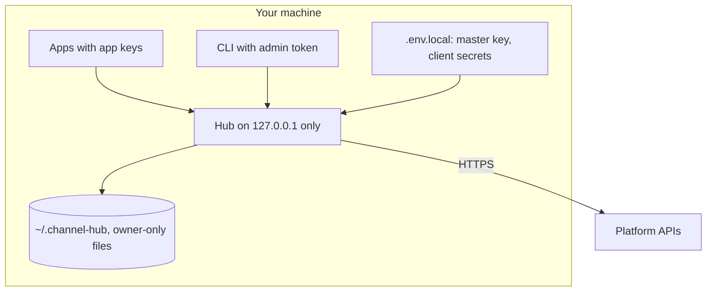

# Security

Channel Hub is a single-owner service that runs on your own machine. It is not designed to be exposed to a network.

Everything inside *Your machine* is trusted to the level of your user account. Only the Hub talks to platforms.

## What is stored where

| Secret | Where | Protection |
|---|---|---|
| Master key, OAuth client secrets | `.env.local` (git-ignored) | Your file permissions. Never committed, never printed. |
| Account refresh tokens / API keys | `~/.channel-hub/vault.json` | AES-256-GCM with the master key, file mode 600. Never returned by any route or tool. |
| Access tokens | Hub memory only | Short-lived, refreshed on demand. |
| App keys | Hash only, `apps.json` | Shown once, or written straight into the app's `.env.local`. Compared in constant time. |
| Admin token | `~/.channel-hub/admin-token.json`, mode 600 | Needed for connecting accounts and managing apps. Never given to apps. Compared in constant time. |

## Protections

- Binds to `127.0.0.1` only; rejects requests whose `Host` is not the Hub (DNS rebinding) and browser requests from
  other origins.
- OAuth `state` is random, single-use, tied to one connector and expires after 10 minutes; PKCE is used.
- Each app may use only the accounts listed for it.
- Video upload session URLs are accepted only for the platform's own hosts. The test-only
  `CHANNEL_HUB_TEST_GOOGLE_BASE_URL` is refused unless it is a loopback address.
- File types are checked on the real file after following symlinks, so a link named `.srt` cannot send another file.
- `--write-env` only writes into files named `.env*.local`, which the usual `.gitignore` rules keep out of git.
- Every publish, captions call, visibility change, account connection and app change is appended to `audit.jsonl`
  (no secrets).
- Public posts need an explicit `confirm_public`; uploads are never retried automatically.

## Limits

- Any program running as your user can read your `.env.local` and data folder. Use full-disk encryption and keep the
  master key safe.
- Apps send local file paths; the Hub reads any file your user can read with an allowed extension (video and captions
  types only) when asked by a valid app key. Give keys only to apps you trust.

## Reporting a problem

Please open a private security advisory on the GitHub repository rather than a public issue.
